# `btn-gke-network-poc-2026` — BTN GCP (GKE Island-Mode) & Simulated Alibaba Cloud Private Connectivity PoC

This repository contains the architecture, Kubernetes manifests, automation/verification scripts, and **step-by-step Google Cloud Console GUI-first configuration guide** (with `gcloud` CLI and `kubectl` equivalents) for simulating **Bank Tabungan Negara (BTN)** hybrid/multi-cloud private connectivity between **Google Cloud (GKE)** and **Alibaba Cloud** in Argolis project **`gcp-demo-02-307713`** (`asia-southeast2`, Jakarta).

For deep-dive architectural explanations, packet-by-packet walkthroughs, **critical GCP Private NAT + Internal Load Balancer engineering gotchas**, and detailed **Google Cloud Console UI click-by-click instructions**, see **[`study-notes.md`](./study-notes.md)**.

---

## 1. Customer Requirements & How This PoC Achieves Them

| # | BTN Requirement | PoC Implementation in `gcp-demo-02-307713` (`asia-southeast2`) | Verification Status |
| :--- | :--- | :--- | :--- |
| **1** | **GKE Island-Mode Network Model**<br>([GKE Network Models Docs](https://docs.cloud.google.com/kubernetes-engine/docs/concepts/gke-compare-network-models#island-mode-model)) | Fresh custom VPC **`btn-gcp-vpc`** with subnet **`btn-gke-subnet`**:<br>• **Node Primary Range:** `10.2.2.0/24`<br>• **Pod Secondary Range (`gke-pods`):** `10.2.16.0/23`<br>• **Service Secondary Range (`gke-services`):** `10.2.18.0/23`<br>All three ranges are **hidden (never advertised over BGP)** to Alibaba Cloud. | ✅ **VERIFIED** (`10.2.2.0/24`, `10.2.16.0/23`, and `10.2.18.0/23` are isolated inside `btn-gcp-vpc` and unroutable from Alibaba Cloud) |
| **2** | **Simulated Alibaba Cloud Environment** | Custom VPC **`sim-alicloud-vpc`** with subnet **`sim-alicloud-subnet` (`192.168.1.0/24`)** and test VM **`sim-alicloud-vm` (`192.168.1.10`)** running a JSON HTTP echo server on port `80` that returns/logs the observed client source IP. | ✅ **VERIFIED** (`sim-alicloud-vm` running at `192.168.1.10`) |
| **3** | **Private Connectivity Between GCP & Alibaba Cloud** | **HA VPN** (`btn-gcp-havpn` $\leftrightarrow$ `sim-alicloud-havpn`) with 2 IPsec IKEv2 tunnels (`tun0`, `tun1`) and dynamic eBGP between **`btn-gcp-router` (`ASN 65001`)** and **`sim-alicloud-router` (`ASN 65002`)**. | ✅ **VERIFIED** (Both VPN tunnels `ESTABLISHED`, both BGP sessions `UP`) |
| **4** | **Outbound (Egress) from GKE Pods Uses 1 Private SNAT IP (`/32`)** | **Hybrid Private NAT** (`btn-private-nat-gw`, `--type=PRIVATE`, rule `100` with `--match="nexthop.is_hybrid"`) using `PRIVATE_NAT` subnet **`btn-private-nat-subnet` (`10.2.99.96/29`)** *(minimum `/29` prefix required by GCP for `PRIVATE_NAT`, enclosing `.98`–`.101`)*. Translates all GKE Pod egress (`10.2.16.0/23` $\rightarrow$ `192.168.1.0/24`) to a single `/32` IP (**`10.2.99.99/32`**). | ✅ **VERIFIED** (Pods on both GKE nodes `10.2.17.12` and `10.2.16.8` arrive at `192.168.1.10` with `"observed_client_ip": "10.2.99.99"`) |
| **5** | **Inbound (Ingress) from Alibaba Cloud Uses 1 Single Private VIP (`/32`)** | **Regional Internal Application Load Balancer (`INTERNAL_MANAGED`)** on static VIP **`10.2.2.200/32` (`btn-gke-ilb-vip`)** backed by GKE Service **`btn-echo-svc`** Standalone NEG (**`btn-echo-neg`**) and proxy-only subnet **`btn-proxy-only-subnet` (`10.2.20.0/23`)**. | ✅ **VERIFIED** (`curl http://10.2.2.200/` from `192.168.1.10` returns `HTTP 200` from GKE Pods `10.2.16.8` & `10.2.17.12`) |
| **6** | **Strict BGP Route Advertisement (`1 /32` Outbound + `1 /32` Inbound from GCP)** | **`btn-gcp-router`** configured in `CUSTOM` advertisement mode advertising **strictly two `/32` host routes**:<br>1. **`10.2.99.99/32`** (Outbound Private NAT SNAT VIP)<br>2. **`10.2.2.200/32`** (Inbound GKE Internal Load Balancer VIP)<br>**`sim-alicloud-router`** advertises `192.168.1.0/24`. | ✅ **VERIFIED** (`sim-alicloud-router` BGP table contains **only** `10.2.99.99/32` and `10.2.2.200/32` from `ASN 65001`) |

---

## 2. Architecture Diagram

```mermaid
flowchart LR
    subgraph AliCloud["☁️ Simulated Alibaba Cloud VPC (sim-alicloud-vpc | ASN 65002)"]
        direction TB
        AliSub["Subnet: sim-alicloud-subnet<br/>192.168.1.0/24"]
        AliVM["🖥️ sim-alicloud-vm<br/>IP: 192.168.1.10:80<br/>(HTTP Source-IP Inspector & Client)"]
        AliRouter["🧭 sim-alicloud-router (ASN 65002)<br/>Advertises: 192.168.1.0/24<br/>Learns ONLY:<br/>• 10.2.99.99/32 (Egress SNAT)<br/>• 10.2.2.200/32 (Ingress ILB)"]
        AliVPN["🔒 sim-alicloud-havpn"]
        AliSub --- AliVM
        AliVM --- AliRouter --- AliVPN
    end

    subgraph VPN["🔗 Private HA VPN (IPsec IKEv2 + eBGP)"]
        Tun0["Tunnel 0: 169.254.0.1/30 ↔ 169.254.0.2/30"]
        Tun1["Tunnel 1: 169.254.1.1/30 ↔ 169.254.1.2/30"]
    end

    subgraph GCP["☁️ Google Cloud Island-Mode GKE VPC (btn-gcp-vpc | ASN 65001)"]
        direction TB
        GCPRouter["🧭 btn-gcp-router (ASN 65001)<br/>CUSTOM BGP Advertisement:<br/>• 10.2.99.99/32 (1 /32 Outbound)<br/>• 10.2.2.200/32 (1 /32 Inbound)<br/>❌ Hides 10.2.2.0/24, 10.2.16.0/23,<br/>10.2.18.0/23, 10.2.20.0/23, 10.2.99.96/29"]
        GCPVPN["🔒 btn-gcp-havpn"]

        subgraph EgressNAT["📤 Outbound Path (Hybrid Private NAT)"]
            NatGW["🛡️ btn-private-nat-gw (type=PRIVATE)<br/>Rule 100: match='nexthop.is_hybrid'<br/>Subnet: btn-private-nat-subnet (10.2.99.96/29)<br/>Active SNAT IP: 10.2.99.99/32"]
        end

        subgraph IngressILB["📥 Inbound Path (Regional Internal ALB)"]
            ILBVIP["🎯 Forwarding Rule: btn-gke-ilb-fr<br/>Static VIP: 10.2.2.200/32 (:80)<br/>Proxy Subnet: 10.2.20.0/23<br/>(ENDPOINT_TYPE_MANAGED_PROXY_LB)"]
        end

        subgraph GKEIsland["🏝️ GKE Cluster: btn-gke-island-cluster (Hidden Island Ranges)"]
            Nodes["Nodes Primary Range: 10.2.2.0/24<br/>(Node 1: 10.2.2.4, Node 2: 10.2.2.3)"]
            Pods["Pods Secondary Range: 10.2.16.0/23<br/>(Pod 1: 10.2.17.12, Pod 2: 10.2.16.8)<br/>Standalone NEG: btn-echo-neg (:8080)"]
            Svcs["Services Secondary Range: 10.2.18.0/23<br/>(btn-echo-svc ClusterIP)"]
        end

        GCPVPN --- GCPRouter
        Pods -->|"1. Egress: 10.2.16.x → 192.168.1.10"| NatGW
        NatGW -->|"2. SNAT to 10.2.99.99/32"| GCPRouter
        GCPRouter -->|"3. Ingress to 10.2.2.200/32"| ILBVIP
        ILBVIP -->|"4. Proxy (10.2.20.x) → Pod NEG (10.2.16.x:8080)"| Pods
    end

    AliVPN <==>|"BGP + IPsec"| VPN <==>|"BGP + IPsec"| GCPVPN
```



---

## 3. Two Critical GCP Engineering Findings (Must-Know for BTN Design)

> [!IMPORTANT]
> Testing this architecture live in `gcp-demo-02-307713` uncovered **two critical Google Cloud networking behaviors** that every architect designing GKE Island-Mode with Hybrid Private NAT must account for:

### Finding 1: Why GCP `PRIVATE_NAT` Requires a `/29` Subnet (`10.2.99.96/29`), `/29` IP Math (`8` Total vs. `4` Usable IPs), & How SNAT Selects `10.2.99.99/32`

1. **Minimum `/29` Subnet Prefix Length (`8` Total IPs = `4` GCP-Reserved + `4` Usable Host IPs):**
   - In Google Cloud, a Private NAT gateway (`--type=PRIVATE`) cannot use a standalone reserved `/32` IP resource (`--source-nat-active-ips` is only supported for `PUBLIC` NAT), and GCP blocks manual static IP reservations inside a `PRIVATE_NAT` subnet (`PRIVATE_NAT subnetwork cannot be used for address reservation`).
   - Instead, Private NAT requires a dedicated subnet with `--purpose=PRIVATE_NAT`, and the Compute Engine API enforces a **minimum subnet size of `/29`**. Passing `10.2.99.100/32` directly fails with `Invalid IPCidrRange: 10.2.99.100/32. Prefix length must be at most 29`.
   - **Why does `10.2.99.96/29` have `8` total IPs (`10.2.99.96`–`10.2.99.103`), of which `4` are usable by Private NAT?**
     In standard CIDR math, a `/29` block has $2^{(32-29)} = 2^3 = \mathbf{8\text{ total IP addresses}}$ (`10.2.99.96` through `10.2.99.103`). Unlike traditional on-premises networks (which reserve only 2 IPs per subnet: network and broadcast), **every Google Cloud VPC primary subnet reserves 4 IP addresses**, leaving **4 usable host IPs** for Private NAT:

     | IP Address in `10.2.99.96/29` | Status in Google Cloud VPC (`PRIVATE_NAT`) | Can Private NAT Emit Packets from This IP? |
     | :--- | :--- | :--- |
     | **`10.2.99.96`** | **Reserved by GCP** — Subnet Network Address (1st IP) | ❌ **Never** |
     | **`10.2.99.97`** | **Reserved by GCP** — Default Subnet Gateway (2nd IP) | ❌ **Never** |
     | **`10.2.99.98`** | ✅ **Usable Private NAT IP #1** | ✅ **Yes** (Allocated as secondary/spillover range) |
     | **`10.2.99.99`** | ✅ **Usable Private NAT IP #2** *(Primary Active IP in PoC)* | ✅ **Yes** (Used first by greedy sequential allocation) |
     | **`10.2.99.100`** | ✅ **Usable Private NAT IP #3** | ✅ **Yes** (Available in `/29` pool as nodes/ports scale) |
     | **`10.2.99.101`** | ✅ **Usable Private NAT IP #4** | ✅ **Yes** (Available in `/29` pool as nodes/ports scale) |
     | **`10.2.99.102`** | **Reserved by GCP** — Second-to-last IP (Reserved for future use) | ❌ **Never** |
     | **`10.2.99.103`** | **Reserved by GCP** — Subnet Broadcast Address (Last IP) | ❌ **Never** |

2. **How Private NAT Selects `10.2.99.99` First (Greedy Sequential Allocation) & When Spillover Can Happen:**
   - When `btn-private-nat-subnet` (`10.2.99.96/29`) is attached to Rule `100` (`--match="nexthop.is_hybrid"`), Cloud NAT assigns port blocks from the `/29` pool to each GKE Node (for example, `10.2.99.99:1024-1039`, `10.2.99.99:32768-32783`, and `10.2.99.98:1024-1039` on Node 1).
   - **Greedy Sequential Selection:** For any destination `(dst_ip, dst_port, protocol)` tuple (e.g., `192.168.1.10:80/TCP`), Google Cloud's Andromeda NAT port allocator does **not** pick randomly across the `/29`. Instead, it allocates ports **greedily and sequentially** starting from the first active IP range (**`10.2.99.99`**). That is why all normal connections from Node 1 (`10.2.99.99:1024..`) and Node 2 (`10.2.99.99:1040..`) deterministically use **`10.2.99.99`**.
   - **Spillover Nuance Under High Concurrency:** If a single GKE Node opens more simultaneous connections (including connections in the 30s `TIME_WAIT` window) to the **exact same `(dst_ip, dst_port, protocol)` endpoint** than the ports currently allocated on `10.2.99.99` before Dynamic Port Allocation steps up, Cloud NAT will spill the next connection over to **`10.2.99.98`**. If BGP only advertises `10.2.99.99/32`, return packets for any spillover connection on `10.2.99.98` will be dropped by Alibaba Cloud.

3. **BTN Firewall & BGP Negotiation Playbook (Option A vs. Option B):**
   - **Option A (Recommended Cloud-Native Pattern — Negotiate `/29` or `4 x /32` Usable IPs with BTN):**
     - Explain to BTN that `/29` (`10.2.99.96/29` = `8` total IPs, `4` usable NAT IPs) is Google Cloud's minimum subnet size for serverless Private NAT (`--type=PRIVATE`).
     - In BTN's firewall and BGP route filter, BTN can either:
       1. Allow the **`/29` block (`10.2.99.96/29`)** or all **`8 x /32` IPs (`10.2.99.96/32`–`10.2.99.103/32`)**, **OR**
       2. If BTN registers individual `/32` host objects in their firewall and wants the fewest possible entries, register only the **`4 x /32` usable host IPs (`10.2.99.98/32`, `10.2.99.99/32`, `10.2.99.100/32`, `10.2.99.101/32`)**, because GCP will never emit traffic from `.96`, `.97`, `.102`, or `.103`.
     - We also recommend setting `--min-ports-per-vm=2048` and `--tcp-time-wait-timeout=30s` on `btn-private-nat-gw` so each GKE node pre-allocates a large port buffer.
   - **Option B (Fallback if BTN Strictly Refuses Anything Beyond `1 x /32` IP `10.2.99.100/32`):**
     - In this PoC, we demonstrate that Cloud Router Custom BGP Advertisement can advertise **strictly `1 /32` (`10.2.99.99/32`)** while keeping `10.2.99.96/29` hidden.
     - However, if BTN's security policy permanently forbids allowing the 4 usable `/32` IPs of `10.2.99.96/29` and requires a **100% mathematical guarantee** that not a single spillover packet ever uses `.98`/`.99`/`.101` under extreme burst load, replace `PRIVATE_NAT` with a lightweight Egress NAT VM / NVA (`10.2.99.100/32`) using Linux kernel `iptables -t nat -A POSTROUTING -d 192.168.1.0/24 -j SNAT --to-source 10.2.99.100`.

### Finding 2: Why Inbound GKE Ingress Must Use a Proxy-Based Internal Load Balancer (`INTERNAL_MANAGED`) Instead of a Passthrough ILB (`INTERNAL`)
1. **Private NAT Applies to `ALL_IP_RANGES` of the GKE Subnet:** When configuring Private NAT (`--type=PRIVATE`), GCP enforces `Only ALL_IP_RANGES is allowed value for sourceIpRangesToNat for private Nats`. Enabling Private NAT on `btn-gcp-vpc` therefore attaches Andromeda's VM Private NAT pipeline (`ENDPOINT_TYPE_VM`) to both the GKE Pod secondary range (`10.2.16.0/23`) **and** the GKE Node primary range (`10.2.2.0/24`).
2. **Why Passthrough ILB (`INTERNAL`) Fails on Return Traffic:** With a Passthrough Internal Network Load Balancer (`load-balancing-scheme=INTERNAL` on `10.2.2.200/32`), inbound `SYN` packets from `192.168.1.10` reach the GKE Node and Pod (`nf_conntrack` enters `SYN_RECV`), and the GKE Node (`ENDPOINT_TYPE_VM`) sends the `SYN-ACK` (`src=10.2.2.200 -> dst=192.168.1.10`) directly back toward the hybrid VPN next hop (`nexthop.is_hybrid`). Because Private NAT (`ENDPOINT_TYPE_VM`) is outbound-only and does not permit unsolicited inbound connections to VMs on a Private-NATed subnet, Andromeda drops the `SYN-ACK`.
3. **How Regional Internal Application Load Balancer (`INTERNAL_MANAGED`) Solves It Cleanly:** By provisioning a **Regional Internal Application Load Balancer** (`load-balancing-scheme=INTERNAL_MANAGED`) on the exact same static VIP **`10.2.2.200/32`** with a proxy-only subnet (`10.2.20.0/23`, `--purpose=REGIONAL_MANAGED_PROXY`) and GKE Standalone NEG (`btn-echo-neg`):
   - Inbound TCP/HTTP connections from Alibaba Cloud (`192.168.1.10`) terminate at Google's managed Envoy proxy (**`ENDPOINT_TYPE_MANAGED_PROXY_LB`**), which is **not** subject to `btn-private-nat-gw` (`ENDPOINT_TYPE_VM`).
   - The Envoy proxy then forwards the request from `10.2.20.x` to the GKE Pod (`10.2.16.x:8080`) completely inside `btn-gcp-vpc` (next-hop is local VPC, not `nexthop.is_hybrid`).
   - The proxy-only subnet (`10.2.20.0/23`) is **never advertised over BGP**—Alibaba Cloud only ever needs the single **`10.2.2.200/32`** route!

---

## 4. Repository Structure & Portable Environment Configuration

All scripts in this repository are **100% portable across any Google Cloud project, region, or IP plan**. They contain **no hardcoded project IDs**—instead, [`scripts/00-env.sh`](./scripts/00-env.sh) automatically detects your active `gcloud config` project, region, and zone (and supports optional overrides via environment variables or a `.env` file copied from [`.env.example`](./.env.example)).

```text
btn-gke-network-poc-2026/
├── README.md                         # Executive summary, architecture, quickstart & verification guide
├── study-notes.md                    # Complete GUI-first step-by-step configuration guide & deep-dive notes
├── .env.example                      # Optional template to override Project ID, Region, Zone, or CIDRs
├── k8s/
│   ├── echo-deployment.yaml          # 2-replica GKE HTTP Echo & Egress Test Deployment
│   └── echo-ilb-service.yaml         # GKE ClusterIP Service with Standalone NEG (btn-echo-neg)
├── scripts/
│   ├── 00-env.sh                     # Dynamic environment auto-discovery (Project ID, Region, Zone, CIDRs)
│   ├── 01-deploy-all.sh              # Portable end-to-end automated provisioning script
│   ├── 02-verify-all.sh              # Portable end-to-end live verification script (5 test suites)
│   ├── 03-cleanup-all.sh             # Portable reverse-dependency cleanup/deprovisioning script
│   └── alicloud-vm-startup.sh        # Startup script for sim-alicloud-vm (HTTP source-IP inspector)
└── logs/
    └── verification_output.txt       # Captured live verification output from reference test run
```

### 4.1 One-Command Quickstart for Any Customer / Partner GCP Project

Any customer or partner can deploy, verify, and tear down this entire PoC in their own GCP project with four commands:

```bash
git clone https://github.com/indrapn00/btn-gke-network-poc-2026.git
cd btn-gke-network-poc-2026

# 1. Dynamically load your active GCP Project ID, Region, and Zone from `gcloud config`
#    (Or set `export PROJECT_ID=your-project-id` / copy `.env.example` to `.env` to customize):
source ./scripts/00-env.sh

# 2. Provision the entire PoC environment (VPCs, HA VPN, BGP, Private NAT, GKE, Internal ALB):
./scripts/01-deploy-all.sh

# 3. Run all 5 Control Plane + Data Plane verification tests (saves output to logs/verification_output.txt):
./scripts/02-verify-all.sh

# 4. Deprovision all PoC resources cleanly when finished:
./scripts/03-cleanup-all.sh
```

---

## 5. Step-by-Step Control Plane & Data Plane Verification Guide (GUI + CLI)

### 5.1 Load Dynamic Environment Variables First
Before running any manual CLI verification commands below, load [`scripts/00-env.sh`](./scripts/00-env.sh) so `$PROJECT_ID`, `$REGION`, `$ZONE`, and all resource names/IPs are set for your environment:
```bash
source ./scripts/00-env.sh
```

---

### 5.2 Test 1 (Control Plane): Verify Strict `/32` BGP Route Advertisements
- **In Google Cloud Console UI:**
  1. Go to **Network Connectivity $\rightarrow$ Cloud Routers $\rightarrow$ `sim-alicloud-router`**.
  2. Click on the **BGP sessions** (`bgp-to-gcp-0` / `bgp-to-gcp-1`) or open **VPC network $\rightarrow$ VPC networks $\rightarrow$ `sim-alicloud-vpc` $\rightarrow$ Routes** (`Dynamic (BGP)` routes).
  3. Confirm that **only** `10.2.2.200/32` (Inbound ILB VIP) and `10.2.99.99/32` (Outbound Private NAT SNAT IP) are learned from `ASN 65001`—and that `10.2.2.0/24` (Nodes), `10.2.16.0/23` (Pods), and `10.2.18.0/23` (Services) are completely absent.
- **Via CLI:**
  ```bash
  source ./scripts/00-env.sh
  gcloud compute routers get-status "$ALICLOUD_ROUTER" \
    --project="$PROJECT_ID" --region="$REGION" \
    --format="yaml(result.bestRoutesForRouter[].destRange,result.bestRoutesForRouter[].nextHopIp)"
  ```
- **Live Output:**
  ```yaml
  bestRoutesForRouter:
  - destRange: 10.2.2.200/32   # 1 /32 Inbound GKE Internal Load Balancer VIP
  - destRange: 10.2.99.99/32   # 1 /32 Outbound GKE Private NAT SNAT IP
  ```

---

### 5.3 Test 2 (Data Plane — Outbound Egress): GKE Pod (`10.2.16.0/23`) $\rightarrow$ Simulated Alibaba Cloud VM (`192.168.1.10`) via Private NAT (`10.2.99.99/32`)

This test proves in the **Data Plane** (at both the network packet layer via `tcpdump` and the HTTP application layer via `/var/log/alicloud-http.log`) that traffic initiated by GKE Pods (`10.2.17.12` on Node `10.2.2.4` and `10.2.16.8` on Node `10.2.2.3`) is source-NATed by `btn-private-nat-gw` so that the Simulated Alibaba Cloud VM (`192.168.1.10`) **only ever sees the single `/32` SNAT IP `10.2.99.99`**.

#### Step A — Open a Live Listener on `sim-alicloud-vm` (`192.168.1.10`)
- **In Google Cloud Console UI:** Go to **Compute Engine $\rightarrow$ VM instances**, find **`sim-alicloud-vm`**, and click **SSH** (opens SSH-in-browser via IAP).
- **Or via CLI:**
  ```bash
  source ./scripts/00-env.sh
  gcloud compute ssh "$ALICLOUD_VM_NAME" --project="$PROJECT_ID" --zone="$ZONE" --tunnel-through-iap
  ```
- Inside `sim-alicloud-vm`, run `tcpdump` on interface `ens4` (or `tail -f /var/log/alicloud-http.log`) to watch incoming packets in real time:
  ```bash
  sudo tcpdump -ni ens4 'tcp port 80'
  ```

#### Step B — Initiate Outbound HTTP Traffic from Inside the GKE Pods (`10.2.17.12` & `10.2.16.8`)
> [!WARNING]
> **Cloud Shell `kubeconfig` Tip:** If you run `kubectl` in Google Cloud Shell and see `Unable to connect to the server: dial tcp <old-ip>:443: i/o timeout`, your Cloud Shell `~/.kube/config` is still pointing to an older, deleted GKE cluster! Always run `gcloud container clusters get-credentials "$GKE_CLUSTER" --zone="$ZONE" --project="$PROJECT_ID"` first.

- From Cloud Shell or your workstation terminal, execute an outbound HTTP GET request from each GKE Pod to the Simulated Alibaba Cloud VM (`http://192.168.1.10/`):
  ```bash
  source ./scripts/00-env.sh
  gcloud container clusters get-credentials "$GKE_CLUSTER" \
    --zone="$ZONE" --project="$PROJECT_ID"

  # 1. Inspect the GKE Pods and their hidden Island-Mode IPs (10.2.17.12 and 10.2.16.8):
  kubectl get pods -l "app=${K8S_APP_NAME}" -o wide

  # 2. Execute HTTP requests from inside each GKE Pod to Simulated Alibaba Cloud VM (192.168.1.10):
  for POD in $(kubectl get pods -l "app=${K8S_APP_NAME}" -o jsonpath='{.items[*].metadata.name}'); do
    POD_IP=$(kubectl get pod "$POD" -o jsonpath='{.status.podIP}')
    NODE_IP=$(kubectl get pod "$POD" -o jsonpath='{.status.hostIP}')
    echo ">>> Sending HTTP GET from GKE Pod $POD (Pod IP: $POD_IP, Node IP: $NODE_IP) -> http://${ALICLOUD_VM_IP}/egress-from-$POD"
    kubectl exec "$POD" -- python3 -c "
  import urllib.request
  with urllib.request.urlopen('http://${ALICLOUD_VM_IP}/egress-from-$POD', timeout=5) as r:
      print('HTTP Status:', r.status)
      print(r.read().decode())
  "
  done
  ```

#### Step C — Observed Data Plane Output (HTTP Response, `tcpdump`, & Alibaba Cloud Server Logs)
1. **HTTP Response Returned to the GKE Pods (`10.2.17.12` on Node `10.2.2.4` and `10.2.16.8` on Node `10.2.2.3`):**
   ```json
   >>> Sending HTTP GET from GKE Pod btn-echo-app-cb955885b-86ftl (Pod IP: 10.2.17.12, Node IP: 10.2.2.4) -> http://192.168.1.10/egress-from-btn-echo-app-cb955885b-86ftl
   HTTP Status: 200
   {
     "service": "Simulated Alibaba Cloud Endpoint (BTN Hybrid PoC)",
     "timestamp": "2026-10-26T04:43:30.423855+00:00",
     "observed_client_ip": "10.2.99.99",
     "observed_client_port": 1024,
     "server_hostname": "sim-alicloud-vm",
     "server_ip": "192.168.1.10",
     "server_port": 80,
     "request_path": "/egress-from-btn-echo-app-cb955885b-86ftl"
   }

   >>> Sending HTTP GET from GKE Pod btn-echo-app-cb955885b-mrp75 (Pod IP: 10.2.16.8, Node IP: 10.2.2.3) -> http://192.168.1.10/egress-from-btn-echo-app-cb955885b-mrp75
   HTTP Status: 200
   {
     "service": "Simulated Alibaba Cloud Endpoint (BTN Hybrid PoC)",
     "timestamp": "2026-10-26T04:43:32.707139+00:00",
     "observed_client_ip": "10.2.99.99",
     "observed_client_port": 1040,
     "server_hostname": "sim-alicloud-vm",
     "server_ip": "192.168.1.10",
     "server_port": 80,
     "request_path": "/egress-from-btn-echo-app-cb955885b-mrp75"
   }
   ```
2. **Packet Capture (`tcpdump` on `sim-alicloud-vm` `ens4`) Showing Only `10.2.99.99` on the Wire:**
   ```text
   04:43:30.420173 IP 10.2.99.99.1024 > 192.168.1.10.80: Flags [S], seq 1118586314, win 42600, length 0
   04:43:30.420232 IP 192.168.1.10.80 > 10.2.99.99.1024: Flags [S.], seq 1776674852, ack 1118586315, length 0
   04:43:30.422787 IP 10.2.99.99.1024 > 192.168.1.10.80: Flags [P.], seq 1:157, ack 1, length 156: HTTP: GET /egress-from-btn-echo-app-cb955885b-86ftl HTTP/1.1
   04:43:30.424344 IP 192.168.1.10.80 > 10.2.99.99.1024: Flags [P.], seq 1:125, ack 157, length 124: HTTP: HTTP/1.0 200 OK
   04:43:32.704304 IP 10.2.99.99.1040 > 192.168.1.10.80: Flags [S], seq 805427931, win 42600, length 0
   04:43:32.704356 IP 192.168.1.10.80 > 10.2.99.99.1040: Flags [S.], seq 3359210763, ack 805427932, length 0
   ```
   *(Notice how Pod 1 on Node 1 uses source port `10.2.99.99:1024` and Pod 2 on Node 2 uses source port `10.2.99.99:1040`—both sharing the exact same single `/32` IP `10.2.99.99`!)*

---

### 5.4 Test 3 (Data Plane — Inbound Ingress): Simulated Alibaba Cloud VM (`192.168.1.10`) $\rightarrow$ GKE Service ILB VIP (`10.2.2.200/32`)

This test proves in the **Data Plane** that the Simulated Alibaba Cloud VM (`192.168.1.10`) can initiate HTTP requests to the GKE service using **only the single `/32` Internal Load Balancer VIP `10.2.2.200`**, and that requests are load-balanced across the GKE Pods (`10.2.16.8` and `10.2.17.12`).

#### Step A — Watch Live GKE Pod Logs
- **In Google Cloud Console UI:** Go to **Kubernetes Engine $\rightarrow$ Workloads $\rightarrow$ `btn-echo-app` $\rightarrow$ Logs** tab.
- **Or via CLI:**
  ```bash
  kubectl logs -l app=btn-echo-app -f --prefix=true
  ```

#### Step B — Send Inbound HTTP Requests from `sim-alicloud-vm` (`192.168.1.10`) to `http://10.2.2.200/`
- Inside the SSH session on **`sim-alicloud-vm`** (or via `gcloud compute ssh`), run:
  ```bash
  source ./scripts/00-env.sh
  gcloud compute ssh "$ALICLOUD_VM_NAME" \
    --project="$PROJECT_ID" --zone="$ZONE" --tunnel-through-iap \
    --command="
  curl -i -s http://${ILB_VIP_ADDRESS}/ingress-from-alicloud-1
  echo ''
  curl -i -s http://${ILB_VIP_ADDRESS}/ingress-from-alicloud-2
  "
  ```

#### Step C — Observed Data Plane Output (HTTP Response, `tcpdump`, & GKE Pod Logs)
1. **HTTP Responses Received on `sim-alicloud-vm` (`192.168.1.10`) from Both GKE Pods (`10.2.16.8` & `10.2.17.12`):**
   ```json
   HTTP/1.1 200 OK
   server: BaseHTTP/0.6 Python/3.11.17
   via: 1.1 google

   {
     "service": "BTN GKE Island-Mode HTTP Workload",
     "direction": "AliCloud-to-GKE-ILB-Ingress",
     "observed_client_ip": "10.2.20.2",
     "request_path": "/ingress-from-alicloud-1",
     "gke_pod_name": "btn-echo-app-cb955885b-mrp75",
     "gke_pod_ip": "10.2.16.8",
     "gke_node_ip": "10.2.2.3",
     "headers": {
       "host": "10.2.2.200",
       "x-forwarded-for": "192.168.1.10,10.2.2.200"
     }
   }

   HTTP/1.1 200 OK
   server: BaseHTTP/0.6 Python/3.11.17
   via: 1.1 google

   {
     "service": "BTN GKE Island-Mode HTTP Workload",
     "direction": "AliCloud-to-GKE-ILB-Ingress",
     "observed_client_ip": "10.2.20.2",
     "request_path": "/ingress-from-alicloud-2",
     "gke_pod_name": "btn-echo-app-cb955885b-86ftl",
     "gke_pod_ip": "10.2.17.12",
     "gke_node_ip": "10.2.2.4",
     "headers": {
       "host": "10.2.2.200",
       "x-forwarded-for": "192.168.1.10,10.2.2.200"
     }
   }
   ```
2. **Packet Capture (`tcpdump` on `sim-alicloud-vm` `ens4`) Showing `192.168.1.10` Communicating Exclusively with Single VIP `10.2.2.200:80`:**
   ```text
   04:49:06.002789 IP 192.168.1.10.55180 > 10.2.2.200.80: Flags [S], seq 1034096099, win 65320, length 0
   04:49:06.005886 IP 10.2.2.200.80 > 192.168.1.10.55180: Flags [S.], seq 1639618629, ack 1034096100, length 0
   04:49:06.006089 IP 192.168.1.10.55180 > 10.2.2.200.80: Flags [P.], seq 1:95, ack 1, length 94: HTTP: GET /ingress-packet-check HTTP/1.1
   04:49:06.009511 IP 10.2.2.200.80 > 192.168.1.10.55180: Flags [P.], seq 1:171, ack 95, length 170: HTTP: HTTP/1.1 200 OK
   ```
3. **Live GKE Pod Container Logs (`kubectl logs -l app=btn-echo-app --prefix=true`):**
   ```text
   [pod/btn-echo-app-cb955885b-mrp75/echo-server] 10.2.20.2 - - [26/Oct/2026 04:43:43] "GET /ingress-from-alicloud-1 HTTP/1.1" 200 -
   [pod/btn-echo-app-cb955885b-86ftl/echo-server] 10.2.20.2 - - [26/Oct/2026 04:43:43] "GET /ingress-from-alicloud-2 HTTP/1.1" 200 -
   ```

---

### 5.5 Test 4 (Data Plane — Negative Isolation Test): Verify GKE Pod & Node Ranges Are Unreachable from Alibaba Cloud

From inside `sim-alicloud-vm` (`192.168.1.10`), attempt to connect directly to a GKE Pod IP (`10.2.17.12:8080` or `10.2.16.8:8080`) or GKE Node IP (`10.2.2.4:80` or `10.2.2.3:80`) bypassing the `/32` ILB VIP:
```bash
source ./scripts/00-env.sh
SamplePodIP=$(kubectl get pods -l "app=${K8S_APP_NAME}" -o jsonpath='{.items[0].status.podIP}')
SampleNodeIP=$(kubectl get pods -l "app=${K8S_APP_NAME}" -o jsonpath='{.items[0].status.hostIP}')

gcloud compute ssh "$ALICLOUD_VM_NAME" \
  --project="$PROJECT_ID" --zone="$ZONE" --tunnel-through-iap \
  --command="
echo '1. Testing direct HTTP to GKE Pod IP ($SamplePodIP:8080) [Expect Timeout]:'
curl -v -m 3 http://$SamplePodIP:8080/ || echo 'PASS: Direct Pod IP $SamplePodIP is unroutable from Alibaba Cloud (Island-Mode Enforced)'
echo '2. Testing direct HTTP to GKE Node IP ($SampleNodeIP:80) [Expect Timeout]:'
curl -v -m 3 http://$SampleNodeIP:80/ || echo 'PASS: Direct Node IP $SampleNodeIP is unroutable from Alibaba Cloud (Island-Mode Enforced)'
"
```
**Observed Output:**
```text
1. Testing direct HTTP to GKE Pod IP (10.2.17.12:8080) [Expect Timeout]:
* Trying 10.2.17.12:8080...
* Connection timed out after 3001 milliseconds
PASS: Direct Pod IP 10.2.17.12 is unroutable from Alibaba Cloud (Island-Mode Enforced)
2. Testing direct HTTP to GKE Node IP (10.2.2.4:80) [Expect Timeout]:
* Trying 10.2.2.4:80...
* Connection timed out after 3001 milliseconds
PASS: Direct Node IP 10.2.2.4 is unroutable from Alibaba Cloud (Island-Mode Enforced)
```

---

## 6. Step-by-Step Configuration Guide

See **[`study-notes.md`](./study-notes.md)** for the complete **Google Cloud Console GUI-first step-by-step configuration guide** (with `gcloud` CLI and `kubectl` commands for every step).
